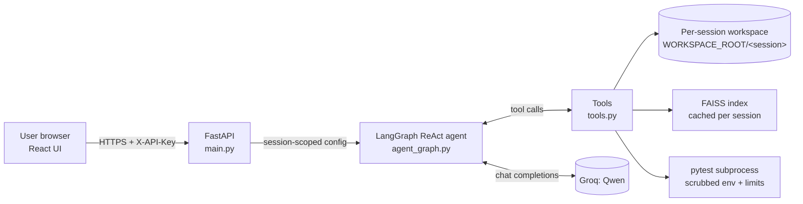

# OpenSWE — Autonomous AI Software Engineer

OpenSWE is a web app where a user uploads a codebase, describes a task in plain English, and an LLM agent **searches the code (RAG), edits files, runs the tests, and reports what it verified**. Each user gets an isolated workspace on the server.

| Layer | Stack |
|---|---|
| Frontend | React 19 + Vite (plain CSS) |
| API | FastAPI + Uvicorn |
| Agent | LangGraph ReAct agent (`create_react_agent`) |
| LLM | Qwen via Groq (`ChatGroq`), configurable |
| RAG | LangChain text splitter + `all-MiniLM-L6-v2` embeddings + FAISS (in-memory) |
| Tests | `pytest` run in a restricted subprocess |

---

## 1. Architecture



### Files

| File | Responsibility |
|---|---|
| `settings.py` | All configuration, read from environment variables / `.env` |
| `tools.py` | The four agent tools, path sandbox, pytest runner, RAG index cache |
| `agent_graph.py` | Builds the LLM client, system prompt, and the ReAct agent graph |
| `main.py` | HTTP API, authentication, rate limiting, concurrency and timeouts |
| `test_tools.py` | Unit tests for the sandbox and tools |
| `Dockerfile`, `.dockerignore` | Container build for deployment |
| `src/App.jsx`, `src/index.css` | Frontend UI |

---

## 2. Request lifecycle (step by step)

1. **Open the site.** The frontend creates a random `session_id`, stores it in `localStorage`, and checks `GET /healthz` every 15 s (the status light).
2. **Settings.** The user enters the backend URL and an API key (stored in the browser only).
3. **Upload code.** The frontend filters out junk (`node_modules`, `.git`, `.venv`, `.env*`, keys, non-text files, files over 200 KB) and sends the rest in batches of 25 to `POST /api/workspace/files`.
4. **Workspace.** The backend writes the files into `WORKSPACE_ROOT/<sha256(key)[:16]>-<session_id>/`. Different API keys or session ids never share a folder.
5. **Submit a task.** The frontend calls `POST /api/run-agent` with `task_description` and `session_id`.
6. **Gatekeeping** (`main.py`), in this order:
   - API key check (constant-time comparison) → `401` if wrong
   - Sliding-window rate limit per key → `429` if exceeded
   - Concurrency semaphore (`MAX_CONCURRENT_RUNS`) → `503` if the server is busy
7. **Agent loop** (`agent_graph.py`). The ReAct loop alternates between the LLM and tools until the LLM answers without calling a tool:

   $$\text{state}_{t+1} = \text{Tool}\big(\text{LLM}(\text{messages}_t)\big)$$

   The loop is capped by `RECURSION_LIMIT` (default 25) → `422` if exceeded, and by `AGENT_TIMEOUT_S` (default 120 s) → `504` if exceeded.
8. **Typical agent behaviour** (from the system prompt):
   1. `search_codebase_rag` to locate relevant code
   2. `read_code_file` to read exact files
   3. `write_code_file` to apply an edit (complete file content)
   4. `run_pytest_suite` to verify; on failure, read output, fix, rerun
   5. Report only what was verified
9. **Response.** The API returns `status`, `session_id`, the final `output` (Qwen `<think>` blocks stripped), and `tools_used`.
10. **Review changes.** The frontend refreshes the file list (`GET /api/workspace/files`); clicking a file calls `GET /api/workspace/file` and shows it with a copy/download option.

---

## 3. The agent tools

| Tool | What it does | Guards |
|---|---|---|
| `read_code_file(file_path)` | Reads a UTF-8 file | Path sandbox, 200 KB cap |
| `write_code_file(file_path, content)` | Creates/overwrites a file atomically (temp file + `os.replace`) | Path sandbox, 200 KB cap |
| `run_pytest_suite(test_path)` | Runs pytest inside the workspace | Scrubbed env, CPU/memory/file-size limits (POSIX), 60 s timeout, process-group kill, output truncated |
| `search_codebase_rag(query)` | Semantic search over the workspace | Per-session cached index, top-4 chunks with file paths |

### Path sandbox (`safe_path`)
Every path is resolved against the session workspace **after symlink resolution**, then checked for containment. Rejected: `..` escapes, absolute paths, `.git`, `.ssh`, `.env*`, `*.pem`, `*.key`, `*.p12`.

---

## 4. How the RAG works

1. **Collect** indexable files (`.py .js .ts .md .json .txt .toml .yaml .yml .cfg .ini`) ≤ 200 KB, skipping `node_modules`, `venv`, `.git`, `__pycache__`, etc.
2. **Fingerprint** = SHA-1 over `(relative path, mtime_ns, size)` of all files. If it matches the cached one, reuse the index.
3. **Chunk** with `RecursiveCharacterTextSplitter` (1000 chars, 200 overlap). Every chunk carries its `source` file path.
4. **Embed** with `all-MiniLM-L6-v2` (384-dimensional, L2-normalised, CPU) and store in an in-memory FAISS index.
5. **Query:** embed the query and return the top-$k$ chunks ($k$ = `RAG_TOP_K`, default 4) by similarity.

**Complexity**

- Index build: $O(T)$ embedding work for $T$ total tokens, which is the **dominant bottleneck** (slow on low-spec CPUs).
- Search: $O(n \cdot d)$ for $n$ chunks and $d = 384$ (exact flat search).
- **Any file change rebuilds the whole index** (no incremental update). A write by the agent therefore costs a re-embed on the next search.
- Cache holds up to `MAX_INDEX_SESSIONS` (16) sessions (LRU). It lives in process memory, so it is lost on restart.

---

## 5. Security model

| Threat | Mitigation |
|---|---|
| Reading/writing outside the workspace | Resolved-path containment, deny-list |
| Cross-user access | Workspace namespaced by `sha256(API key)` + `session_id` |
| Unauthenticated use | `X-API-Key` required; server refuses to start without `API_KEYS` |
| Abuse / cost | Per-key rate limit, concurrency cap, timeouts, step budget, input size limits |
| Secret leakage via agent-run code | pytest runs with a scrubbed environment (no `GROQ_API_KEY`) |
| Runaway tests | 60 s timeout, process-group kill, rlimits (Linux/macOS) |
| Prompt injection from file contents | System prompt marks files/tool output as untrusted data (mitigation, not a guarantee) |
| Browser access from unknown sites | CORS limited to `CORS_ORIGINS` |

**Important limits:** a subprocess is not a true sandbox. Run the container with `--memory 2g --pids-limit 256 --cap-drop ALL --security-opt no-new-privileges`, and for untrusted public users run tests in a separate isolated worker (gVisor, Firecracker, or a service like E2B/Modal). The API key must never be in public browser code; use a server-side proxy for a public deployment.

---

## 6. API reference

All routes except `/` and `/healthz` require the header `X-API-Key: <key>`.

| Method | Route | Purpose |
|---|---|---|
| GET | `/healthz` | Health check |
| POST | `/api/run-agent` | `{task_description, session_id}` → runs the agent |
| POST | `/api/workspace/files` | `{session_id, files:[{path, content}]}` → uploads files |
| GET | `/api/workspace/files?session_id=` | Lists workspace files |
| GET | `/api/workspace/file?session_id=&path=` | Reads one file |

Interactive docs: `http://127.0.0.1:8000/docs`.

| Status | Meaning |
|---|---|
| 401 | Missing/wrong API key |
| 413 / 415 | File too large / not UTF-8 text |
| 422 | Agent exceeded its step budget |
| 429 | Rate limit exceeded |
| 503 | Server busy or Groq rate-limited |
| 504 | Agent exceeded the time limit |

---

## 7. Configuration (`.env`)

| Variable | Default | Meaning |
|---|---|---|
| `GROQ_API_KEY` | — (required) | Groq API key |
| `API_KEYS` | — (required) | Comma-separated client keys |
| `CORS_ORIGINS` | — | Allowed frontend origins, comma-separated, **no trailing slash** |
| `LLM_MODEL` | `qwen/qwen3.8-27b` | Groq model id (must support tool calling) |
| `EMBED_MODEL` | `all-MiniLM-L6-v2` | Embedding model |
| `WORKSPACE_ROOT` | `./workspace` | Where session workspaces live |
| `MAX_FILE_BYTES` | 200000 | Per-file size cap |
| `MAX_TASK_CHARS` | 4000 | Task length cap |
| `AGENT_TIMEOUT_S` | 120 | Run time limit |
| `RECURSION_LIMIT` | 25 | Max agent steps |
| `MAX_CONCURRENT_RUNS` | 4 | Parallel agent runs |
| `RATE_LIMIT_PER_MIN` | 10 | Requests per key per minute |
| `PYTEST_TIMEOUT_S` | 60 | Per test-run limit |
| `RAG_TOP_K` | 4 | Chunks returned per search |
| `MAX_INDEX_SESSIONS` | 16 | Cached indexes |

Never commit `.env`.

---

## 8. Run locally

```powershell
# backend (project root)
python -m venv .venv
.venv\Scripts\Activate.ps1
pip install -r requirements.txt
# create .env (see section 7)
uvicorn main:app --port 8000

# frontend (second terminal, frontend folder)
npm install
npm run dev
```

### Test in three stages
1. **Backend alone:** `pytest test_tools.py -q`; `curl http://127.0.0.1:8000/healthz`; use `/docs` to upload a file and run a task.
2. **Frontend alone:** `npm run dev`; the page loads.
3. **Connection:** the CORS preflight returns `200` with the right `access-control-allow-origin`; the status light is green; upload a file and run a task end to end.

---

## 9. Deployment

| Part | Where | Notes |
|---|---|---|
| Backend | Hugging Face Spaces (Docker) | Add Space README metadata `sdk: docker`, `app_port: 8000`; set secrets in Space settings |
| Frontend | Vercel / Netlify / Render Static | `npm run build`, deploy `dist/` |
| Proxy (recommended) | Vercel serverless function | Holds the API key server-side |

Run **one worker** only: the rate limiter and FAISS cache are in process memory.

---

## 10. Known limitations and roadmap

| Limitation | Impact | Planned fix |
|---|---|---|
| Edits rewrite whole files; output capped at 4096 tokens | Files over ~300 lines can be truncated | Add `read_file_lines` and `replace_in_file` tools |
| Files over 200 KB are rejected/skipped | Large files unsupported | Chunked reads, raise caps carefully |
| Embedding model reads ~256 tokens per chunk | Weaker retrieval on dense code | Smaller chunks or `bge-small-en-v1.5` |
| Whole index rebuilds on any change | Slow after edits | Incremental indexing |
| Runs can exceed host proxy timeouts | 504 on long tasks | Streaming (SSE) or job queue |
| In-memory limiter/cache, ephemeral disk | No multi-replica, lost on restart | Redis, persistent volume |
| No user login | `session_id` is the only separator | Real auth; derive session from user id |
| Tests run beside the API | Risk with untrusted users | Isolated sandbox worker |

---

## 11. Troubleshooting

| Symptom | Likely cause |
|---|---|
| `API_KEYS must be set` at startup | `.env` missing, misnamed (`.env.txt`), or in the wrong folder |
| Status light red, `Disallowed CORS origin` | `CORS_ORIGINS` mismatch (port, `localhost` vs `127.0.0.1`, trailing slash) |
| "rejected your API key" | Browser Settings key differs from `API_KEYS` |
| Port 8000 already in use | Old uvicorn still running; `netstat -ano \| findstr :8000`, then `taskkill /PID <pid> /F` |
| 504 on a task | First RAG index build, many files, or agent looping; raise `AGENT_TIMEOUT_S` or narrow the task |
| Yellow import lines in VS Code | Wrong interpreter; pick `.venv` via *Python: Select Interpreter* |
